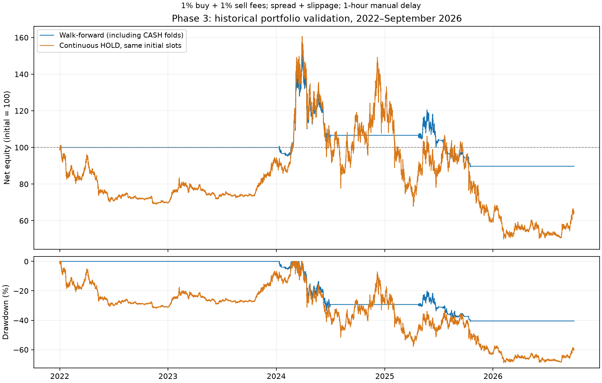

# V11 – fáza 3: režim trhu a validácia stratégií

**Záver: stabilná výhoda sa nepreukázala. Produkčné BUY/SELL pravidlá ponechať nezmenené.**

Samostatná lokálna vetva `research/v11-phase3`, základ `e4c610d` z fázy 2. Výskum nevolá produkčný bot, Telegram ani obchodné API. Nič sa nepushuje, nezlučuje ani nenasadzuje. Všetky sumy a obchody v tejto správe sú simulácie, nie súkromné portfólio.

Preddefinovaný walk-forward postup skončil od 1. 1. 2022 do 1. 10. 2026 na **-10.27 %**, maximálny hodinový drawdown **40.74 %**. Kontinuálne držanie s rovnakými počiatočnými slotmi: **-35.67 %**, drawdown **68.87 %**. Menšia strata a pokles v tomto konkrétnom intervale nestačia na dôkaz stabilnej výhody: postup vynechal rastové polroky, šesť z desiatich testovacích úsekov vybral CASH a aj tak stratil kapitál.

Priemerná hodinová expozícia walk-forward bola iba **6.48 %** oproti **38.43 %** pri kontinuálnom HOLD-sloty. Veľká časť ochrany pochádza z hotovosti. Úplná hotovosť bez úroku by v tomto modeli mala **0 % výnos a 0 % DD** a prekonala by oba postupy; aktívny výber preto nepreukázal ani prínos oproti tejto jednoduchej obrane.

Na poslednom krátkom bloku 1.–20. 10. 2026 vybral rovnaký tréningový selektor **momentum/regime**; výsledok **-9.04 %**, drawdown **14.20 %**, oproti držaniu so slotmi **-7.40 %**. Dvadsať dní nie je dôkaz dlhodobej spoľahlivosti.



Graf pokrýva bežný walk-forward do 1. 10. 2026; posledný 20-dňový blok sa hodnotí samostatne. Vektorová verzia: [walk_forward.svg](walk_forward.svg).

## 1. Rozsah a kvalita dát

- Binance spot OHLCV cez CCXT/Freqtrade, UTC, BTC + SOL, TAO, ONDO, RENDER, AAVE, FET. Denné dáta od roku 2020 slúžia aj na rozohriatie indikátorov; výsledky od roku 2021. Načítaný ETH sa archivuje v manifeste, ale do klasifikátora ani signálov nevstupuje.
- Oddelená lokálna kópia `backtesting/user_data/phase3/binance`; pôvodné dáta fázy 2 zostali zachované. Dáta sa necommitujú. Presné SHA-256, počty riadkov a medzery: [manifest.json](manifest.json).
- Posledný testovaný deň je **20. 10. 2026**. Neskoršie stiahnuté sviečky sa nepoužívajú na historické signály ani obchody.
- Roky 2024 až september 2026 boli prezerané už vo fáze 2. **Nie sú novým nezávislým holdoutom.** Roky 2021–2023 sú nová historická kontrola tejto fázy, nie dokonale zaslepený experiment. Posledný októbrový blok je od tréningu časovo oddelený; všetky jeho výsledky sa zverejňujú vrátane neúspešných.
- Parametre, rozsah vstupov/výstupov, náklady a tréningový selektor boli zapísané v [design.json](../../research/phase3/design.json) pred prvým vyhodnotením matice. Po výsledkoch sa nemenili na dosiahnutie +100 %. Následne sa doplnili technické diagnostiky, samostatné vyhodnotenie posledného bloku tým istým selektorom a plne investovaný benchmark; nejde o externú preregistráciu.
- Pevne vybraných šesť dnešných mincí vytvára **survivorship a výberové skreslenie**. Chýbajú vyradené projekty a pôvodná dobová investovateľná množina. Ani staršie obdobie preto nedokazuje univerzálnu výhodu na kryptotrhu.
- Binance ceny nie sú realizácie na eToro; USDT berieme ako USD. Historický spread eToro, hĺbka knihy, dane a zmena kurzu USD/EUR nie sú dostupné. Nákladový model je explicitný odhad so záťažovým testom, nie potvrdenie skutočných realizačných nákladov.

### Dostupnosť požadovaných indikátorov

| Vstup | Stav | Historická reprezentácia |
| --- | --- | --- |
| BTC denný trend, EMA50/200, momentum | Implementované | Uzavreté denné sviečky, sklon EMA50 za 5 dní, momentum 30 dní |
| ADX, volatilita | Implementované | Denný ADX14 a ATR14/BTC close |
| Objem | Implementované čiastočne | BTC volume × close voči minulému 20-dňovému priemeru; objem jednotlivých altcoinov pri vstupe; nejde o celotrhový objem |
| Relatívna sila altcoinov | Implementované čiastočne | Podiel dostupných sledovaných mincí s 30-dňovým výnosom nad BTC; minimálne dve mince |
| Celková kapitalizácia | **N/A v teste** | Historický CoinGecko endpoint v tomto prostredí vrátil HTTP 401; nie je spoľahlivá dobová séria |
| BTC dominancia | **N/A v teste** | Spoľahlivá časovo označená historická séria nie je dostupná; neodvodzuje sa z ceny BTC ani z týchto šiestich mincí |

Voliteľný adaptér `global_history()` prijíma denné CSV s `date`, `available_at`, `total_cap_usd`, `btc_dominance_pct`, `source_url`, `vintage_type=first_release`. Vyžaduje UTC/časové pásmo, uzavretý deň, prvé vydanie, spojitú dennú sériu a rastúce časy publikácie. Prepisované súčasné hodnoty nepovažuje za historické prvé vydania. Adaptér neoveruje pravdivosť deklarácie poskytovateľa; tú treba doložiť pri získaní zdroja. V tomto behu sa žiadny taký súbor nepoužil. **Úplná požadovaná kombinácia vrátane kapitalizácie a dominancie zostáva neoverená.** Ich dostupnosť sa nenahrádza nulou ani hlasom do klasifikácie.


| Minca | Prvý dostupný deň | Hodinové sviečky v archíve | Počet behov chýbajúcich hodín |
| --- | --- | --- | --- |
| BTC | 2020-01-01 | 59620 | 15 |
| SOL | 2020-08-11 | 54274 | 10 |
| AAVE | 2020-10-15 | 52717 | 10 |
| FET | 2020-01-01 | 59620 | 15 |
| TAO | 2024-04-11 | 22152 | 0 |
| RENDER | 2024-07-26 | 19609 | 0 |
| ONDO | 2025-04-11 | 13390 | 0 |

Nezalistované mince nemajú pred prvými dátami cenu, objem ani signál. Denná EMA200 navyše potrebuje 200 uzavretých dní; ONDO preto väčšinu roku 2025 nespĺňa rozohriatie. História RENDER nezačína starým RNDR a nie je s ním dodatočne spojená. Medzera v hodinových dátach nevytvára obchod: chýbajúca realizačná cena čaká na skutočnú sviečku. Ocenenie otvorenej pozície používa poslednú známu cenu a počíta `stale_position_hours`; drawdown v medzere nemusí zachytiť skutočný priebeh. Výstup na hranici okna so zastaranou cenou je zakázaný.

Zdroje: [Binance spot klines](https://developers.binance.com/docs/binance-spot-api-docs/rest-api/market-data-endpoints#klinecandlestick-data), [Freqtrade download-data](https://www.freqtrade.io/en/stable/data-download/), [CoinGecko historická globálna kapitalizácia](https://docs.coingecko.com/reference/global-market-cap-chart).

## 2. Režim trhu a pravidlá

**BULL jadro:** BTC close > EMA200 × 1,02, EMA50 > EMA200 a kladný 5-dňový sklon EMA50. **BEAR jadro:** close < EMA200 × 0,98 a zároveň aspoň jedna z podmienok: EMA50 < EMA200, alebo momentum30 < −10 % spolu s close < EMA50. Bez jadra je NEUTRAL.

Doplňujúce smerové hlasy: znamienko BTC momentum30, ADX ≥20 v smere jadra, relatívny BTC objem ≥1,1 spolu so znamienkom denného výnosu a altcoinová relatívna šírka ≥60 % / ≤40 %. Potrebná je aspoň polovica dostupných hlasov zaokrúhlená nahor. ATR/BTC close >6 % blokuje nové zaradenie BULL, neblokuje BEAR. Ak raz budú doložené globálne série, adaptér pridá znamienko 30-dňového rastu kapitalizácie a 30-dňovú zmenu dominancie ≤−0,5 / ≥+0,5 percentuálneho bodu. Tieto dva hlasy boli v celom tomto teste N/A.

Režim sa zmení až po **troch po sebe idúcich denných potvrdeniach** a minimálne **piatich dňoch od poslednej zmeny**. Denný signál je dostupný až na začiatku nasledujúceho dňa. Stav sa počíta priebežne od rozohriatia, nie nanovo podľa výsledku jednotlivého testovacieho okna.

| Režim | Nové nákupy | Existujúce pozície |
| --- | --- | --- |
| BULL | Všetky štyri potvrdené vstupy; horná hranica novej expozície 70 % | HOLD pri bežnej korekcii; výstup podľa testovaného variantu |
| NEUTRAL | Iba breakout/retest s RVOL ≥1,8, ADX ≥25, nad dennou EMA200 a RSI 50–68; nová expozícia najviac 25 % | Bez núteného zníženia len kvôli NEUTRAL; hotovosť má prednosť pri nových vstupoch |
| BEAR | Žiadne nové nákupy | Režimový a hybridný variant vykoná ochranný výstup; ostatné varianty držia do svojho stopu |

Limity platia pri prijímaní nákupov, nie ako každohodinové rebalansovanie. Rast ceny môže zvýšiť váhu existujúcej pozície nad limit. Nové nákupy berú do úvahy ostatné pozície a zostávajúcu hotovosť. Náklady sa odpočítavajú z hotovosti; páka, short a pôžička nie sú povolené. Expozícia sa oceňuje čistou likvidačnou hodnotou, preto sa nerovná súčtu hrubých debetov.

### Vstupy na uzavretej 4H sviečke

- **Pullback:** low ≤ EMA20, close > EMA20 > EMA50, RSI 40–65, zlepšenie MACD histogramu a close nad dennou EMA200.
- **Breakout + objem:** prvý close nad maximom predchádzajúcich 20 sviečok, RVOL ≥1,5, ADX ≥20, close nad 4H EMA200.
- **Retest:** návrat k už skôr prerazenej 20-sviečkovej rezistencii do 12 sviečok, low do 1 % nad úrovňou, rastová sviečka s close nad úrovňou, RVOL ≥1 a close nad dennou EMA200. Prerazenie a jeho retest nesmú byť tá istá sviečka; close viac než 0,5 ATR pod úrovňou nastavenie ruší.
- **Momentum:** EMA20 > EMA50 > EMA200, RSI 50–68, kladný MACD histogram, RVOL ≥1,2 a vzdialenosť close od EMA20 najviac 2 ATR.

Všetky vstupy potrebujú rozohriatu 4H aj dennú EMA200 a kladný objem. Opätovný nákup vyžaduje nový platný vstup, aktuálny povolený režim a aspoň 24 hodín od výstupu. Samotný návrat ceny hore nákup nevytvára.

### Výstupy

| Variant | Pravidlo |
| --- | --- |
| Pevný | 20 % pod skutočnou stredovou vstupnou cenou |
| ATR | Vstupná cena − 3 × posledný dostupný 4H ATR14; pevný po vstupe |
| Trailing | 20 % pod maximom už uzavretých hodinových high; počiatočný stop tiež 20 % |
| Režim | Odchod pri potvrdenom BEAR, bez cenového stopu; zámerne rizikový kontrolný variant |
| Hybrid | Pevný 20 % stop alebo potvrdený BEAR, podľa toho, čo sa začne vykonávať skôr |

Stop nie je garantovaná realizačná cena ani limit straty celého portfólia. Malé korekcie samy osebe nevytvárajú SELL. Konkrétny 20 % stop, ATR či trailing je experiment na porovnanie, nie nové produkčné odporúčanie.

## 3. Náklady, manuálne vykonanie a metriky

Simulačný kapitál **8500 USD**, maximálny debet jedného nového nákupu **1000 USD**, najviac jedna pozícia na mincu; súbežný spoločný účet. Základný benchmark **HOLD-sloty** má rovnaký maximálny prvý vklad 1000 USD do každej zo šiestich mincí a zvyšok v hotovosti; pri neskoršom zalistovaní použije rezervovaný slot. **HOLD-100 %** investuje celý počiatočný kapitál rovnakým dielom len do mincí s cenou na začiatku okna; ďalšie listingy nepridáva. Oba držia do plánovaného konca a platia rovnaké náklady. HOLD-100 % má vyššiu rizikovú expozíciu; zníženie drawdownu oproti nemu samo osebe nie je dôkaz lepšej selekcie.

- Poplatok 1 % z nákupného plnenia a 1 % z predajného plnenia, zvlášť spread **0,10 % na každú stranu** a sklz **0,10 % na každú stranu**. Celý nákupný debet obsahuje poplatok; pri predaji sa odpočíta z výnosu. Nákup a okamžitý predaj za rovnaký mid stráca približne 2,37 %.
- Základné oneskorenie **1 hodina** od dostupnosti signálu; test 0, 4 a 12 hodín. Nula je idealizovaná referencia. Používa sa skutočný neskorší hodinový open, nikdy cena pred dostupnosťou signálu. Vstup po 24 hodinách expiruje, pri plnení sa režim znovu preveruje.
- Stop z hourly low je známy až po uzavretí hodiny: výstup na open po uzavretí + manuálne oneskorenie. Gap sa zistí na jeho open a čaká na oneskorené vykonanie. Trailing z aktuálneho high sa zvýši až po uzavretí hodiny, platí od ďalšej hodiny; nepredpokladá poradie high/low.
- Výnos je konečný čistý kapitál / počiatočný kapitál −1. **DD** je maximálny hodinový pokles od dovtedajšieho maxima celého účtu vrátane otvorených pozícií, po odhadovaných výstupných nákladoch. Intrahodinový drawdown môže byť väčší.
- Počet obchodov je počet uzavretých pozícií vrátane plánovanej likvidácie na konci okna. **PF** je súčet čistých kladných PnL / absolútny súčet čistých záporných PnL. N/A znamená žiadne stratové obchody alebo žiadne obchody, nie nekonečnú kvalitu stratégie.
- Každé samostatné okno začína novým kapitálom a bez pozícií. Konečná likvidácia je vopred daná hranicou testu; nejde o predpoveď obratu. Ročné výsledky sa nesčítavajú ako jeden účet. Len walk-forward krivka prenáša realizovaný kapitál medzi úsekmi.

## 4. Všetky stratégie: výsledky po obdobiach

Δ HOLD znamená rozdiel výnosu oproti HOLD-sloty v percentuálnych bodoch. Záporná delta znamená horší výsledok. Všetkých 20 kombinácií je zverejnených; žiadna sa neoznačuje za víťaza podľa najlepšieho roka. Kompletné strojové výsledky a náklady: [results.csv](results.csv), [results.json](results.json).

### 2021

Nová historická kontrola, mimo tréningu budúcich walk-forward úsekov. Samostatné tabuľkové kombinácie sú opisné; záväzný výber len z minulosti je v časti walk-forward.

| Stratégia | Obchody | Čistý výnos % | DD % | PF | Δ HOLD p. b. |
| --- | --- | --- | --- | --- | --- |
| HOLD-sloty | 3 | 1371.70 | 59.77 | N/A | 0.00 |
| HOLD-100 % | 3 | 3886.49 | 65.92 | N/A | 2514.79 |
| CASH (bez úroku) | 0 | 0.00 | 0.00 | N/A | -1371.70 |
| Pullback / pevný 20 % | 4 | 182.49 | 55.27 | 68.55 | -1189.21 |
| Pullback / 3 × ATR | 5 | 182.85 | 55.27 | 79.21 | -1188.85 |
| Pullback / trailing 20 % | 18 | 5.13 | 11.68 | 1.29 | -1366.57 |
| Pullback / režim | 6 | 67.94 | 44.53 | 8.39 | -1303.76 |
| Pullback / 20 % + režim | 7 | 70.71 | 44.02 | 12.02 | -1300.99 |
| Breakout + objem / pevný 20 % | 8 | 59.35 | 29.10 | 4.84 | -1312.35 |
| Breakout + objem / 3 × ATR | 9 | 3.43 | 20.65 | 1.28 | -1368.27 |
| Breakout + objem / trailing 20 % | 18 | -2.42 | 12.27 | 0.85 | -1374.12 |
| Breakout + objem / režim | 6 | 48.32 | 42.15 | 4.83 | -1323.38 |
| Breakout + objem / 20 % + režim | 9 | 9.50 | 19.18 | 1.60 | -1362.21 |
| Retest / pevný 20 % | 7 | 92.98 | 53.12 | 24.63 | -1278.72 |
| Retest / 3 × ATR | 13 | -5.42 | 19.59 | 0.70 | -1377.12 |
| Retest / trailing 20 % | 16 | 3.19 | 8.17 | 1.24 | -1368.51 |
| Retest / režim | 6 | 49.91 | 45.63 | 4.69 | -1321.79 |
| Retest / 20 % + režim | 9 | 47.46 | 45.50 | 5.06 | -1324.24 |
| Momentum / pevný 20 % | 4 | 169.20 | 55.05 | 72.60 | -1202.51 |
| Momentum / 3 × ATR | 5 | 168.57 | 55.32 | 57.35 | -1203.13 |
| Momentum / trailing 20 % | 20 | 9.10 | 7.99 | 1.56 | -1362.60 |
| Momentum / režim | 6 | 67.51 | 45.36 | 7.39 | -1304.19 |
| Momentum / 20 % + režim | 7 | 72.44 | 44.14 | 13.88 | -1299.26 |

### 2022

Nová historická kontrola, mimo tréningu budúcich walk-forward úsekov. Samostatné tabuľkové kombinácie sú opisné; záväzný výber len z minulosti je v časti walk-forward.

| Stratégia | Obchody | Čistý výnos % | DD % | PF | Δ HOLD p. b. |
| --- | --- | --- | --- | --- | --- |
| HOLD-sloty | 3 | -30.29 | 31.88 | 0.00 | 0.00 |
| HOLD-100 % | 3 | -85.83 | 88.42 | 0.00 | -55.54 |
| CASH (bez úroku) | 0 | 0.00 | 0.00 | N/A | 30.29 |
| Pullback / pevný 20 % | 0 | 0.00 | 0.00 | N/A | 30.29 |
| Pullback / 3 × ATR | 0 | 0.00 | 0.00 | N/A | 30.29 |
| Pullback / trailing 20 % | 0 | 0.00 | 0.00 | N/A | 30.29 |
| Pullback / režim | 0 | 0.00 | 0.00 | N/A | 30.29 |
| Pullback / 20 % + režim | 0 | 0.00 | 0.00 | N/A | 30.29 |
| Breakout + objem / pevný 20 % | 1 | -2.63 | 3.45 | 0.00 | 27.67 |
| Breakout + objem / 3 × ATR | 1 | -1.19 | 2.54 | 0.00 | 29.10 |
| Breakout + objem / trailing 20 % | 1 | -1.44 | 2.27 | 0.00 | 28.85 |
| Breakout + objem / režim | 1 | -3.94 | 4.97 | 0.00 | 26.36 |
| Breakout + objem / 20 % + režim | 1 | -2.63 | 3.45 | 0.00 | 27.67 |
| Retest / pevný 20 % | 0 | 0.00 | 0.00 | N/A | 30.29 |
| Retest / 3 × ATR | 0 | 0.00 | 0.00 | N/A | 30.29 |
| Retest / trailing 20 % | 0 | 0.00 | 0.00 | N/A | 30.29 |
| Retest / režim | 0 | 0.00 | 0.00 | N/A | 30.29 |
| Retest / 20 % + režim | 0 | 0.00 | 0.00 | N/A | 30.29 |
| Momentum / pevný 20 % | 0 | 0.00 | 0.00 | N/A | 30.29 |
| Momentum / 3 × ATR | 0 | 0.00 | 0.00 | N/A | 30.29 |
| Momentum / trailing 20 % | 0 | 0.00 | 0.00 | N/A | 30.29 |
| Momentum / režim | 0 | 0.00 | 0.00 | N/A | 30.29 |
| Momentum / 20 % + režim | 0 | 0.00 | 0.00 | N/A | 30.29 |

### 2023

Nová historická kontrola, mimo tréningu budúcich walk-forward úsekov. Samostatné tabuľkové kombinácie sú opisné; záväzný výber len z minulosti je v časti walk-forward.

| Stratégia | Obchody | Čistý výnos % | DD % | PF | Δ HOLD p. b. |
| --- | --- | --- | --- | --- | --- |
| HOLD-sloty | 3 | 189.80 | 38.38 | N/A | 0.00 |
| HOLD-100 % | 3 | 537.78 | 58.91 | N/A | 347.98 |
| CASH (bez úroku) | 0 | 0.00 | 0.00 | N/A | -189.80 |
| Pullback / pevný 20 % | 9 | 35.52 | 16.24 | 3.33 | -154.28 |
| Pullback / 3 × ATR | 10 | 41.02 | 10.95 | 5.20 | -148.79 |
| Pullback / trailing 20 % | 17 | 12.54 | 12.44 | 1.85 | -177.27 |
| Pullback / režim | 6 | 40.17 | 13.04 | 4.78 | -149.64 |
| Pullback / 20 % + režim | 9 | 37.50 | 14.40 | 3.82 | -152.30 |
| Breakout + objem / pevný 20 % | 7 | 74.92 | 20.68 | 8.57 | -114.89 |
| Breakout + objem / 3 × ATR | 9 | 76.27 | 19.49 | 9.92 | -113.54 |
| Breakout + objem / trailing 20 % | 19 | 17.39 | 10.38 | 1.97 | -172.41 |
| Breakout + objem / režim | 6 | 60.73 | 19.33 | 11.98 | -129.07 |
| Breakout + objem / 20 % + režim | 8 | 58.67 | 19.48 | 6.93 | -131.13 |
| Retest / pevný 20 % | 7 | 51.80 | 11.34 | 6.08 | -138.01 |
| Retest / 3 × ATR | 9 | 52.76 | 10.38 | 6.71 | -137.04 |
| Retest / trailing 20 % | 16 | 15.45 | 11.39 | 2.05 | -174.35 |
| Retest / režim | 5 | 52.05 | 12.61 | 6.23 | -137.76 |
| Retest / 20 % + režim | 7 | 51.80 | 11.34 | 6.08 | -138.01 |
| Momentum / pevný 20 % | 8 | 51.76 | 14.70 | 5.21 | -138.05 |
| Momentum / 3 × ATR | 10 | 32.51 | 11.09 | 4.46 | -157.30 |
| Momentum / trailing 20 % | 19 | 10.92 | 9.20 | 1.70 | -178.88 |
| Momentum / režim | 6 | 31.45 | 16.98 | 4.01 | -158.35 |
| Momentum / 20 % + režim | 9 | 30.63 | 12.98 | 3.49 | -159.18 |

### 2024

Už prezerané dáta fázy 2. Samostatné tabuľkové kombinácie sú opisné; záväzný výber len z minulosti je v časti walk-forward.

| Stratégia | Obchody | Čistý výnos % | DD % | PF | Δ HOLD p. b. |
| --- | --- | --- | --- | --- | --- |
| HOLD-sloty | 5 | 35.33 | 46.90 | 8.97 | 0.00 |
| HOLD-100 % | 3 | 111.86 | 64.44 | N/A | 76.53 |
| CASH (bez úroku) | 0 | 0.00 | 0.00 | N/A | -35.33 |
| Pullback / pevný 20 % | 13 | 5.85 | 43.26 | 1.29 | -29.48 |
| Pullback / 3 × ATR | 23 | -3.68 | 43.67 | 0.85 | -39.01 |
| Pullback / trailing 20 % | 30 | -4.55 | 24.60 | 0.86 | -39.89 |
| Pullback / režim | 4 | 35.40 | 37.00 | 21.58 | 0.07 |
| Pullback / 20 % + režim | 13 | 5.85 | 43.26 | 1.29 | -29.48 |
| Breakout + objem / pevný 20 % | 10 | 16.26 | 41.69 | 2.07 | -19.08 |
| Breakout + objem / 3 × ATR | 13 | 13.41 | 40.59 | 1.81 | -21.92 |
| Breakout + objem / trailing 20 % | 23 | -7.62 | 19.49 | 0.68 | -42.95 |
| Breakout + objem / režim | 4 | 30.37 | 34.88 | 15.64 | -4.96 |
| Breakout + objem / 20 % + režim | 10 | 16.26 | 41.69 | 2.07 | -19.08 |
| Retest / pevný 20 % | 11 | 9.89 | 40.38 | 1.60 | -25.44 |
| Retest / 3 × ATR | 15 | 6.29 | 40.58 | 1.35 | -29.04 |
| Retest / trailing 20 % | 28 | -11.05 | 25.57 | 0.64 | -46.39 |
| Retest / režim | 4 | 36.23 | 36.73 | 13.48 | 0.90 |
| Retest / 20 % + režim | 11 | 9.89 | 40.38 | 1.60 | -25.44 |
| Momentum / pevný 20 % | 12 | 10.50 | 41.21 | 1.61 | -24.83 |
| Momentum / 3 × ATR | 16 | 7.60 | 41.41 | 1.42 | -27.73 |
| Momentum / trailing 20 % | 28 | -18.60 | 28.01 | 0.49 | -53.93 |
| Momentum / režim | 4 | 31.95 | 36.74 | 12.10 | -3.38 |
| Momentum / 20 % + režim | 12 | 10.50 | 41.21 | 1.61 | -24.83 |

### 2025

Už prezerané dáta fázy 2. Samostatné tabuľkové kombinácie sú opisné; záväzný výber len z minulosti je v časti walk-forward.

| Stratégia | Obchody | Čistý výnos % | DD % | PF | Δ HOLD p. b. |
| --- | --- | --- | --- | --- | --- |
| HOLD-sloty | 6 | -43.61 | 49.54 | 0.00 | 0.00 |
| HOLD-100 % | 5 | -62.11 | 69.05 | 0.00 | -18.50 |
| CASH (bez úroku) | 0 | 0.00 | 0.00 | N/A | 43.61 |
| Pullback / pevný 20 % | 10 | -23.00 | 27.07 | 0.00 | 20.61 |
| Pullback / 3 × ATR | 10 | -10.95 | 14.85 | 0.00 | 32.66 |
| Pullback / trailing 20 % | 16 | -20.39 | 23.42 | 0.15 | 23.22 |
| Pullback / režim | 5 | -18.20 | 25.08 | 0.03 | 25.41 |
| Pullback / 20 % + režim | 10 | -21.13 | 25.63 | 0.00 | 22.48 |
| Breakout + objem / pevný 20 % | 11 | -23.93 | 32.78 | 0.06 | 19.68 |
| Breakout + objem / 3 × ATR | 12 | -15.73 | 25.50 | 0.09 | 27.88 |
| Breakout + objem / trailing 20 % | 17 | -13.42 | 20.75 | 0.36 | 30.19 |
| Breakout + objem / režim | 5 | -13.99 | 27.47 | 0.07 | 29.62 |
| Breakout + objem / 20 % + režim | 11 | -23.04 | 32.24 | 0.06 | 20.57 |
| Retest / pevný 20 % | 11 | -23.93 | 27.61 | 0.03 | 19.68 |
| Retest / 3 × ATR | 15 | -17.13 | 19.94 | 0.04 | 26.48 |
| Retest / trailing 20 % | 18 | -20.04 | 23.62 | 0.24 | 23.57 |
| Retest / režim | 5 | -18.79 | 25.72 | 0.00 | 24.83 |
| Retest / 20 % + režim | 11 | -22.31 | 26.57 | 0.03 | 21.30 |
| Momentum / pevný 20 % | 10 | -19.09 | 29.68 | 0.12 | 24.52 |
| Momentum / 3 × ATR | 20 | -22.12 | 27.23 | 0.11 | 21.49 |
| Momentum / trailing 20 % | 19 | -11.12 | 20.64 | 0.40 | 32.49 |
| Momentum / režim | 5 | -13.30 | 27.21 | 0.11 | 30.32 |
| Momentum / 20 % + režim | 10 | -15.14 | 26.74 | 0.15 | 28.47 |

### 2026_seen

Už prezerané dáta fázy 2. Samostatné tabuľkové kombinácie sú opisné; záväzný výber len z minulosti je v časti walk-forward.

| Stratégia | Obchody | Čistý výnos % | DD % | PF | Δ HOLD p. b. |
| --- | --- | --- | --- | --- | --- |
| HOLD-sloty | 6 | 14.43 | 36.77 | 16.61 | 0.00 |
| HOLD-100 % | 6 | 20.44 | 48.02 | 16.61 | 6.01 |
| CASH (bez úroku) | 0 | 0.00 | 0.00 | N/A | -14.43 |
| Pullback / pevný 20 % | 6 | 4.54 | 6.56 | 23.59 | -9.89 |
| Pullback / 3 × ATR | 6 | 4.54 | 6.56 | 23.59 | -9.89 |
| Pullback / trailing 20 % | 6 | 4.28 | 6.56 | 22.28 | -10.15 |
| Pullback / režim | 6 | 4.54 | 6.56 | 23.59 | -9.89 |
| Pullback / 20 % + režim | 6 | 4.54 | 6.56 | 23.59 | -9.89 |
| Breakout + objem / pevný 20 % | 7 | 9.13 | 6.38 | 4.69 | -5.30 |
| Breakout + objem / 3 × ATR | 7 | 10.13 | 6.41 | 7.52 | -4.30 |
| Breakout + objem / trailing 20 % | 7 | 11.45 | 6.45 | 147.17 | -2.98 |
| Breakout + objem / režim | 7 | 9.43 | 6.39 | 5.29 | -5.00 |
| Breakout + objem / 20 % + režim | 7 | 9.13 | 6.38 | 4.69 | -5.30 |
| Retest / pevný 20 % | 6 | 6.63 | 6.47 | 7.65 | -7.80 |
| Retest / 3 × ATR | 6 | 6.57 | 6.47 | 7.18 | -7.86 |
| Retest / trailing 20 % | 6 | 6.33 | 6.47 | 7.35 | -8.10 |
| Retest / režim | 6 | 6.63 | 6.47 | 7.65 | -7.80 |
| Retest / 20 % + režim | 6 | 6.63 | 6.47 | 7.65 | -7.80 |
| Momentum / pevný 20 % | 6 | 7.21 | 6.66 | 10.90 | -7.21 |
| Momentum / 3 × ATR | 6 | 7.21 | 6.66 | 10.90 | -7.21 |
| Momentum / trailing 20 % | 6 | 6.95 | 6.66 | 10.53 | -7.48 |
| Momentum / režim | 6 | 7.21 | 6.66 | 10.90 | -7.21 |
| Momentum / 20 % + režim | 6 | 7.21 | 6.66 | 10.90 | -7.21 |

### 2026_short_holdout

Časovo oddelený krátky holdout, 1.–20. 10. 2026. Samostatné tabuľkové kombinácie sú opisné; záväzný výber len z minulosti je v časti walk-forward.

| Stratégia | Obchody | Čistý výnos % | DD % | PF | Δ HOLD p. b. |
| --- | --- | --- | --- | --- | --- |
| HOLD-sloty | 6 | -7.40 | 14.29 | 0.00 | 0.00 |
| HOLD-100 % | 6 | -10.48 | 20.01 | 0.00 | -3.08 |
| CASH (bez úroku) | 0 | 0.00 | 0.00 | N/A | 7.40 |
| Pullback / pevný 20 % | 6 | -8.88 | 13.57 | 0.00 | -1.47 |
| Pullback / 3 × ATR | 7 | -8.96 | 10.36 | 0.00 | -1.56 |
| Pullback / trailing 20 % | 6 | -8.70 | 11.27 | 0.00 | -1.30 |
| Pullback / režim | 6 | -8.60 | 14.12 | 0.00 | -1.20 |
| Pullback / 20 % + režim | 6 | -8.88 | 13.57 | 0.00 | -1.47 |
| Breakout + objem / pevný 20 % | 3 | -6.08 | 6.87 | 0.00 | 1.32 |
| Breakout + objem / 3 × ATR | 3 | -4.02 | 4.02 | 0.00 | 3.38 |
| Breakout + objem / trailing 20 % | 3 | -5.55 | 6.28 | 0.00 | 1.85 |
| Breakout + objem / režim | 3 | -5.40 | 7.63 | 0.00 | 2.00 |
| Breakout + objem / 20 % + režim | 3 | -6.08 | 6.87 | 0.00 | 1.32 |
| Retest / pevný 20 % | 4 | -8.84 | 10.04 | 0.00 | -1.44 |
| Retest / 3 × ATR | 5 | -8.18 | 8.19 | 0.00 | -0.78 |
| Retest / trailing 20 % | 5 | -10.76 | 10.76 | 0.00 | -3.36 |
| Retest / režim | 4 | -7.86 | 10.72 | 0.00 | -0.46 |
| Retest / 20 % + režim | 4 | -8.84 | 10.04 | 0.00 | -1.44 |
| Momentum / pevný 20 % | 6 | -9.43 | 13.78 | 0.00 | -2.03 |
| Momentum / 3 × ATR | 10 | -11.94 | 12.93 | 0.00 | -4.53 |
| Momentum / trailing 20 % | 8 | -13.52 | 15.71 | 0.00 | -6.12 |
| Momentum / režim | 6 | -9.04 | 14.20 | 0.00 | -1.64 |
| Momentum / 20 % + režim | 6 | -9.43 | 13.78 | 0.00 | -2.03 |

### Stabilita medzi rokmi

Šesť úsekov 2021–2025 a január–september 2026 má rozdielnu dĺžku. Mediány nižšie nie sú anualizovaný výnos ani štatistický test; ukazujú, či výhoda pretrváva medzi obdobiami. Posledný krátky holdout sa do tejto sumarizácie nepoužíva.

| Stratégia | Lepšia než HOLD /6 | Kladný výnos /6 | Medián Δ HOLD p. b. | Medián zníženia DD p. b. | Najhorší DD % |
| --- | --- | --- | --- | --- | --- |
| Breakout + objem / 3 × ATR | 2 | 4 | -13.11 | 26.69 | 40.59 |
| Breakout + objem / pevný 20 % | 2 | 4 | -12.19 | 23.07 | 41.69 |
| Breakout + objem / 20 % + režim | 2 | 4 | -12.19 | 23.67 | 41.69 |
| Breakout + objem / režim | 2 | 4 | -4.98 | 20.56 | 42.15 |
| Breakout + objem / trailing 20 % | 2 | 2 | -22.97 | 29.20 | 20.75 |
| Momentum / 3 × ATR | 2 | 4 | -17.47 | 24.80 | 55.32 |
| Momentum / pevný 20 % | 2 | 4 | -16.02 | 21.77 | 55.05 |
| Momentum / 20 % + režim | 2 | 4 | -16.02 | 24.10 | 44.14 |
| Momentum / režim | 2 | 4 | -5.30 | 21.86 | 45.36 |
| Momentum / trailing 20 % | 2 | 3 | -30.70 | 29.65 | 28.01 |
| Pullback / 3 × ATR | 2 | 3 | -24.45 | 28.82 | 55.27 |
| Pullback / pevný 20 % | 2 | 4 | -19.68 | 22.31 | 55.27 |
| Pullback / 20 % + režim | 2 | 4 | -19.68 | 23.95 | 44.02 |
| Pullback / režim | 3 | 4 | -4.91 | 24.90 | 44.53 |
| Pullback / trailing 20 % | 2 | 3 | -25.02 | 28.16 | 24.60 |
| Retest / 3 × ATR | 2 | 3 | -18.45 | 29.95 | 40.58 |
| Retest / pevný 20 % | 2 | 4 | -16.62 | 24.48 | 53.12 |
| Retest / 20 % + režim | 2 | 4 | -16.62 | 25.01 | 45.50 |
| Retest / režim | 3 | 4 | -3.45 | 24.80 | 45.63 |
| Retest / trailing 20 % | 2 | 3 | -27.24 | 28.64 | 25.57 |

Príznak **nestabilná** platí pre všetkých 20 kombinácií: menia sa výnosy aj relatívne poradie podľa obdobia a krátky holdout nepriniesol potvrdenie. Záporná delta počas silných rastov je cena za nižšiu expozíciu, neskoršie vstupy a výstupy; neznamená automaticky programátorskú chybu. Ani kladný rozdiel v medveďom roku nedokazuje všeobecnú nadvýkonnosť.

## 5. Porovnanie režimov a prínosu indikátorov

Nasledujúce priemery sú **retrospektívna diagnostika**, nikdy vstup do klasifikátora, výberu modelu či obchodov. Dopredné okná sa musia celé zmestiť do daného obdobia. Prekrývajú sa, preto nejde o nezávislé vzorky ani odhad budúceho výnosu. Nie je k dispozícii objektívny označený „pravý režim“; neuvádzame zavádzajúcu percentuálnu presnosť.

| Obdobie | Režim | Dní | BTC ďalších 7 dní priemer % | BTC ďalších 30 dní priemer % |
| --- | --- | --- | --- | --- |
| 2021 | BEAR | 78 | 1.42 | 10.67 |
| 2021 | NEUTRAL | 163 | 3.06 | 12.58 |
| 2021 | BULL | 124 | -0.64 | -4.38 |
| 2022 | BEAR | 274 | -1.55 | -3.85 |
| 2022 | NEUTRAL | 91 | -1.66 | -14.79 |
| 2022 | BULL | 0 | N/A | N/A |
| 2023 | BEAR | 37 | 3.58 | 11.95 |
| 2023 | NEUTRAL | 147 | 2.88 | 9.70 |
| 2023 | BULL | 181 | 1.09 | 5.28 |
| 2024 | BEAR | 0 | N/A | N/A |
| 2024 | NEUTRAL | 171 | 2.12 | 11.16 |
| 2024 | BULL | 195 | 1.53 | 6.89 |
| 2025 | BEAR | 65 | -1.41 | -3.87 |
| 2025 | NEUTRAL | 207 | 0.30 | 0.28 |
| 2025 | BULL | 93 | -0.08 | -0.73 |
| 2026_seen | BEAR | 155 | 0.14 | -1.56 |
| 2026_seen | NEUTRAL | 102 | -0.70 | 1.57 |
| 2026_seen | BULL | 16 | 5.71 | N/A |
| 2026_short_holdout | BEAR | 0 | N/A | N/A |
| 2026_short_holdout | NEUTRAL | 0 | N/A | N/A |
| 2026_short_holdout | BULL | 20 | -1.94 | N/A |

| Obdobie | Surové prepnutia | Potvrdené prepnutia |
| --- | --- | --- |
| 2021 | 39 | 14 |
| 2022 | 34 | 13 |
| 2023 | 30 | 13 |
| 2024 | 55 | 19 |
| 2025 | 39 | 9 |
| 2026_seen | 45 | 12 |
| 2026_short_holdout | 0 | 0 |

Hysterézia znížila počet prepnutí z 242 na 80. Nezaručila však predikciu smeru: v roku 2021 mal BULL záporný priemerný nasledujúci 30-dňový výnos BTC, zatiaľ čo BEAR kladný; v poslednom krátkom bloku bol režim celý čas BULL napriek strate portfólia. Model prevažne rozpoznáva už existujúci trend a niekedy zaostáva za obratom.

### Ablácia: odstránenie jednotlivých vstupov

Zmena oproti plnému dostupnému modelu, vždy rovnaký vstup, hybridný výstup, kapitál a obdobie. 24 párov na variant (4 vstupy × 6 období), nie 24 nezávislých trhov. Kladná Δ výnosu znamená, že **odstránenie** indikátora zlepšilo výnos; kladná Δ DD znamená väčší pokles po odstránení. Global cap/dominance sa abláciou netestujú, pretože boli N/A. Žiadny parameter sa po tejto tabuľke nezavádza do produkcie.

| Odstránený vstup / model | Medián Δ výnosu p. b. | Min Δ | Max Δ | Medián Δ DD p. b. | Lepší výnos po odstránení |
| --- | --- | --- | --- | --- | --- |
| no_adx | -0.67 | -27.87 | 2.84 | 0.00 | 5/24 |
| no_entry_regime_filter | 0.18 | -22.96 | 78.80 | 9.31 | 12/24 |
| no_momentum | -2.76 | -27.87 | 9.71 | -0.68 | 6/24 |
| no_relative | 0.00 | -10.59 | 10.90 | 0.00 | 8/24 |
| no_volatility | 0.00 | 0.00 | 33.96 | 0.00 | 4/24 |
| no_volume | 0.00 | -0.81 | 2.84 | 0.00 | 3/24 |
| trend_only | 0.00 | -18.69 | 38.53 | 0.00 | 11/24 |

`trend_only` používa len jadro trendu; `no_entry_regime_filter` ruší iba režimové obmedzenie vstupov, hybridný BEAR výstup zostáva. Nesmie sa interpretovať ako stratégia úplne bez trhu. Ak indikátor nezmení výsledky, znamená to nulový realizovaný prínos v tejto konfigurácii, nie dôkaz jeho univerzálnej zbytočnosti. Rozdiely jednotlivých vstupov sú v [ablation_pairs.csv](ablation_pairs.csv).

V tomto experimente majú **momentum a ADX najsľubnejší čiastkový prínos**: ich odstránenie zhoršilo medián čistého výnosu, no účinok nie je rovnaký v každom období. Relatívna sila altcoinov a objem majú medián rozdielu nulový a zmiešané výsledky. Odstránenie volatility zvýšilo výnos v niektorých scenároch a inde ho nezmenilo; súčasný prah preto nemá preukázaný stabilný výnosový prínos. Ani jeden z týchto ex-post výsledkov nie je nezávislým potvrdením optimálnej kombinácie.

### Oneskorená detekcia a prudké pohyby

V [bear_transitions.csv](bear_transitions.csv) je pri každom potvrdenom prechode do BEAR pokles BTC od dovtedy známeho 30-dňového maxima. Ide o zaostávanie oproti minulému vrcholu, nie odhad skutočného začiatku medvedieho trhu. Dodatočný záťažový test posúva **všetky** režimové zmeny o 3 alebo 7 dní; nemá privilégium včasného BEAR výstupu.

Počet potvrdených BEAR prechodov v celej rozohriatej histórii: 18. Medián už prebehnutého 30-dňového poklesu pri prechode: **-14.83 %**, najhlbší **-36.71 %**. Tieto hodnoty zahŕňajú aj rok 2020 a slúžia iba diagnostike.

## 6. Diagnostika výstupov a stratových obchodov

Nasledujúce počty združujú všetky štyri vstupy a šesť dlhších období v rámci daného typu výstupu. Rovnaký trhový pohyb sa môže objaviť vo viacerých stratégiách; **súčty PnL naprieč variantmi nie sú výnos jedného portfólia**. Detail každej simulovanej transakcie: [trades.csv.gz](trades.csv.gz), [trade_diagnostics.csv.gz](trade_diagnostics.csv.gz). Príspevky mincí v spoločnej hotovosti: [coin_contributions.csv](coin_contributions.csv); nie sú nezávislé plne investované sólo účty.

„Odraz bez pokrytia nákladov“ znamená rast close po 7 dňoch a zároveň žiadne dostupné hourly low nižšie než nákladová hranica pre zachovanie rovnakého množstva pri predaji a opätovnom nákupe (približne −2,37 % od výstupného mid). Požaduje sa úplných 168 hodín aj dozretý budúci close v tom istom okne. Je to kandidát zbytočného predaja pri krátkej korekcii, **nie dôkaz**, že obchodník mal vopred vedieť, kedy držať či nakúpiť späť.

| Výstup | Dôvod | Obchody | Stratové | Priem. čistý obchod % | Medián pôv. stopu % | Priem. náklady USD | Odraz 7d / dozreté | Odraz bez pokrytia / úplné |
| --- | --- | --- | --- | --- | --- | --- | --- | --- |
| 3 × ATR | scheduled_end | 53 | 4 | 121.09 | 9.29 | 38.30 | 0/0 | 0/0 |
| 3 × ATR | stop_observed | 167 | 161 | -11.29 | 9.77 | 22.19 | 79/165 | 17/164 |
| pevný 20 % | scheduled_end | 55 | 5 | 143.28 | 20.00 | 40.88 | 0/0 | 0/0 |
| pevný 20 % | stop_observed | 113 | 106 | -17.82 | 20.00 | 21.40 | 69/112 | 17/111 |
| 20 % + režim | bear_regime | 21 | 8 | 94.92 | 20.00 | 35.15 | 9/21 | 0/21 |
| 20 % + režim | scheduled_end | 48 | 5 | 63.52 | 20.00 | 31.13 | 0/0 | 0/0 |
| 20 % + režim | stop_observed | 110 | 103 | -17.76 | 20.00 | 21.76 | 67/109 | 17/108 |
| režim | bear_regime | 57 | 39 | 18.70 | N/A | 26.12 | 29/57 | 5/57 |
| režim | scheduled_end | 52 | 9 | 63.90 | N/A | 30.83 | 0/0 | 0/0 |
| trailing 20 % | scheduled_end | 26 | 9 | 5.64 | 20.00 | 23.78 | 0/0 | 0/0 |
| trailing 20 % | stop_observed | 322 | 213 | -0.72 | 20.00 | 23.85 | 163/313 | 48/305 |

Príčiny, ktoré treba rozlišovať:

1. **Úzke ATR stop-lossy v pokojnom trhu.** Ich šírka sa odvodzuje od 4H ATR, zatiaľ čo pozície sa držia celé dni. Náhodná krátka korekcia môže prevýšiť túto šírku. Následný odraz a náklady opakovaných vstupov môžu zhoršiť čistý výsledok. Širší stop však zároveň zvyšuje riziko; jeho automatické rozšírenie z týchto pozorovaní nevyplýva.
2. **Trailing odovzdáva časť zisku a predčasne ukončuje volatilné rastúce pozície.** Vysoký počet ziskových uzavretých obchodov alebo menšia priemerná strata neznamená vyšší výnos portfólia. Rozhodujúce sú tabuľky výnos/DD oproti pevnému a režimovému variantu.
3. **Pevný stop nerešpektuje spoločný trhový režim.** Môže dlhšie držať zhoršujúci sa trend; hybrid sa snaží odísť skôr. Naopak BEAR klasifikácia zaostáva a niekedy odíde po značnej časti poklesu.
4. **Poplatky, spread a sklz.** Každé ukončenie a nový vstup spotrebujú kapitál aj bez nesprávneho smeru. Čistý stratový obchod môže mať kladnú zmenu mid ceny, ak nepokryla náklady. Záverečné plánované uzavretia sú v tabuľke oddelené od skutočných ochranných signálov.
5. **Manuálne čakanie a korelované straty viacerých mincí.** Skutočný neskorší open môže byť horší než stop; 20 % stop na pozícii nie je zárukou 20 % limitu účtu. Tréningové DD ≤20 % nezabránilo testovaciemu DD nad 30 %.

Nie je správne odstrániť stop len preto, že po niektorých predajoch prišiel odraz. Porovnanie režimového variantu bez cenového stopu s hybridom ukazuje kompromis výnosu a otvoreného rizika; ani jeden nemá nezávisle potvrdenú stabilnú výhodu. Predaj má v ďalšom výskume zmysel posudzovať podľa čistého portfóliového výsledku a poklesu oproti HOLD, nie podľa počtu úspešných výstupov.

### Príspevky mincí v roku 2025: hybrid

Toto sú štyri alternatívne simulácie jedného spoločného účtu, nie štyri časti jedného kombinovaného portfólia.

| Vstup | Minca | Obchody | Čistý PnL USD | Náklady USD | PF |
| --- | --- | --- | --- | --- | --- |
| Breakout + objem | AAVE | 1 | 132.02 | 25.60 | N/A |
| Breakout + objem | FET | 3 | -649.24 | 64.14 | 0.00 |
| Breakout + objem | RENDER | 1 | -215.91 | 21.38 | 0.00 |
| Breakout + objem | SOL | 2 | -342.81 | 43.85 | 0.00 |
| Breakout + objem | TAO | 4 | -882.51 | 85.31 | 0.00 |
| Momentum | AAVE | 1 | 231.81 | 26.81 | N/A |
| Momentum | FET | 2 | -430.58 | 42.78 | 0.00 |
| Momentum | RENDER | 2 | -438.65 | 42.69 | 0.00 |
| Momentum | SOL | 1 | 3.55 | 24.05 | N/A |
| Momentum | TAO | 4 | -653.42 | 88.09 | 0.00 |
| Pullback | AAVE | 1 | -17.77 | 23.79 | 0.00 |
| Pullback | FET | 2 | -447.93 | 42.57 | 0.00 |
| Pullback | RENDER | 2 | -424.02 | 42.86 | 0.00 |
| Pullback | SOL | 2 | -266.38 | 44.78 | 0.00 |
| Pullback | TAO | 3 | -640.11 | 64.25 | 0.00 |
| Retest | AAVE | 1 | 56.60 | 24.69 | N/A |
| Retest | FET | 1 | -227.55 | 21.24 | 0.00 |
| Retest | RENDER | 2 | -373.93 | 43.47 | 0.00 |
| Retest | SOL | 2 | -358.48 | 43.66 | 0.00 |
| Retest | TAO | 5 | -993.38 | 99.82 | 0.00 |

Nulový príspevok chýbajúcej mince znamená žiadny uzavretý obchod, nie nulovú trhovú výkonnosť. Starú stratu −43,44 % pôvodného TrendComponent rieši [fáza 2](../phase2/REPORT.md); táto fáza testuje iný, oddelený výskumný engine a nesmie jej výsledok spätne premenovať na opravenú produkčnú históriu.

## 7. Walk-forward a posledné nezávislé časové okno

Šesť mesiacov tréningu → nasledujúcich šesť mesiacov testu; posledný bežný úsek júl–september 2026 je skrátený dostupnými dátami. Výber len z 20 vopred uvedených kombinácií: aspoň päť uzavretých tréningových obchodov, čistý výnos >0, tréningové DD ≤20 %, PF ≥1 a aspoň jeden stratový obchod na definovanie PF. Spomedzi spôsobilých maximum **výnos − 0,5 × DD**; deterministické riešenie zhody. Bez spôsobilého kandidáta CASH, nie dodatočné uvoľnenie pravidiel.

Na začiatku každého testovacieho úseku je kapitál z konca predchádzajúceho; veľkosť slotu je stále rovnaký podiel 1000/8500 z tohto počiatočného kapitálu. Na hranici úseku sa pozície plánovane zlikvidujú vrátane nákladov; žiadne predstieranie bezplatného presunu. HOLD pri každom úseku v tabuľke tiež začína nanovo; kontinuálny HOLD v úvodnom porovnaní sa nelikviduje každých šesť mesiacov.

| Tréning | Test do (bez) | Vybraný model | Obchody | Čistý výnos % | DD % | PF | HOLD-sloty % |
| --- | --- | --- | --- | --- | --- | --- | --- |
| 2021-07-01 → 2022-01-01 | 2022-01-01 → 2022-07-01 | momentum/trailing | 0 | 0.00 | 0.00 | N/A | -28.87 |
| 2022-01-01 → 2022-07-01 | 2022-07-01 → 2023-01-01 | CASH | 0 | 0.00 | 0.00 | N/A | -7.85 |
| 2022-07-01 → 2023-01-01 | 2023-01-01 → 2023-07-01 | CASH | 0 | 0.00 | 0.00 | N/A | 30.43 |
| 2023-01-01 → 2023-07-01 | 2023-07-01 → 2024-01-01 | CASH | 0 | 0.00 | 0.00 | N/A | 79.23 |
| 2023-07-01 → 2024-01-01 | 2024-01-01 → 2024-07-01 | breakout/atr | 7 | 6.61 | 33.41 | 1.76 | 8.11 |
| 2024-01-01 → 2024-07-01 | 2024-07-01 → 2025-01-01 | CASH | 0 | 0.00 | 0.00 | N/A | 33.51 |
| 2024-07-01 → 2025-01-01 | 2025-01-01 → 2025-07-01 | breakout/hybrid | 4 | -2.52 | 17.00 | 0.65 | -21.35 |
| 2025-01-01 → 2025-07-01 | 2025-07-01 → 2026-01-01 | breakout/trailing | 10 | -13.66 | 15.19 | 0.14 | -34.39 |
| 2025-07-01 → 2026-01-01 | 2026-01-01 → 2026-07-01 | CASH | 0 | 0.00 | 0.00 | N/A | -13.55 |
| 2026-01-01 → 2026-07-01 | 2026-07-01 → 2026-10-01 | CASH | 0 | 0.00 | 0.00 | N/A | 34.70 |

Celý bežný walk-forward: **21 obchodov**, čistý PF **0.69**, poplatky **424.36 USD**, spread a sklz **84.87 USD**. Jednotlivé realizácie z vybraných modelov: [walk_forward_trades.csv](walk_forward_trades.csv).

Časová separácia walk-forward je implementovaná, ale historické výsledky 2024–september 2026 už boli skúmané vo fáze 2. Označenie „out-of-sample“ tu znamená mimo konkrétneho tréningového úseku, **nie úplne nepoznaný trh pri navrhovaní výskumu**. Tréningové skóre nepredpovedalo spoľahlivo budúce poradie. Hotovosť obmedzila straty v medveďom trhu, ale vynechala silný rast v roku 2023 a v časti 2024.

Posledný blok používa rovnaký selektor natrénovaný **1. 4.–30. 9. 2026**, model **momentum/regime**, výsledok **-9.04 %**, PF **0.00**, obchodov **6**. Tento výsledok nebol použitý na zmenu parametrov. Verejne uvedených všetkých 20 variantov krátkeho bloku neslúži na dodatočný výber víťaza. Skutočná dlhšia budúca validácia od 21. 10. 2026 ešte len musí prebehnúť bez zmien pravidiel.

Detaily: [walk_forward.csv](walk_forward.csv), [walk_forward_training.csv](walk_forward_training.csv), [walk_forward_summary.json](walk_forward_summary.json), [final_policy.json](final_policy.json), [final_holdout_training.csv](final_holdout_training.csv).

### Ambícia +100 % za 3–6 mesiacov

Cieľ nebol optimalizačná podmienka. Na jednej spojitej walk-forward krivke majú kĺzavé denné konce 90/180-dňových okien tieto výsledky; okná sa silno prekrývajú a nie sú pravdepodobnosťou budúceho úspechu.

| Okno dní | Prekrývajúce sa okná | Aspoň +100 % | Medián výnosu % | Najhorší výnos % |
| --- | --- | --- | --- | --- |
| 90 | 1644 | 0 | 0.00 | -28.47 |
| 180 | 1554 | 0 | 0.00 | -27.97 |

Tento experiment neposkytuje podklad očakávať +100 % za 3–6 mesiacov. Najlepší historický rok alebo obchod nie je očakávaný budúci výnos.

## 8. Robustnosť, náklady a manuálne oneskorenie

Jedna zmena parametra oproti zodpovedajúcemu základnému variantu, bez nového vyberania na holdoute. Parametre režimu, stopu a náklady používajú pullback; ATR2/4 sa porovnávajú s ATR3 a trailing15/25 s trailing20, ostatné s hybridom. Číselný rozsah je naprieč šiestimi dlhšími obdobiami, nie interval spoľahlivosti. Kladná Δ DD je zhoršenie.

| Zmena | Medián Δ výnosu p. b. | Min Δ | Max Δ | Medián Δ DD p. b. |
| --- | --- | --- | --- | --- |
| atr2 | 0.00 | -4.97 | 5.82 | 0.00 |
| atr4 | -0.01 | -5.57 | 0.32 | 0.00 |
| band0 | 0.00 | -10.07 | 3.88 | 0.00 |
| band4 | 0.00 | -23.61 | 0.00 | 0.00 |
| confirm2 | -0.89 | -10.80 | 17.49 | 0.05 |
| confirm5 | -7.53 | -27.94 | 0.00 | 0.46 |
| dwell10 | 0.00 | -23.37 | 0.00 | 0.00 |
| dwell3 | 0.00 | 0.00 | 0.00 | 0.00 |
| extreme_cost | -1.90 | -2.52 | 0.00 | 0.09 |
| high_cost | -0.72 | -0.95 | 0.00 | 0.03 |
| raw | -3.66 | -13.26 | 1.37 | 1.15 |
| regime_lag3 | -5.45 | -18.94 | 0.36 | 0.00 |
| regime_lag7 | -1.86 | -19.65 | 1.67 | 0.19 |
| stop15 | 1.42 | -1.84 | 5.15 | -0.63 |
| stop25 | 0.14 | 0.00 | 22.71 | -0.07 |
| trail15 | -0.49 | -12.25 | 5.63 | -1.65 |
| trail25 | 1.49 | -1.67 | 23.69 | 0.46 |
| vol4 | 0.00 | -70.71 | 2.54 | -0.33 |
| vol8 | 0.00 | 0.00 | 7.48 | 0.00 |

`confirm2/5`: počet denných potvrdení; `dwell3/10`: minimálne trvanie stavu; `band0/4`: pásmo EMA200 0/4 %; `vol4/8`: ATR/BTC limit 4/8 %; `regime_lag3/7`: ďalšie oneskorenie všetkých režimov; `raw`: potvrdenie aj dwell po 1 dni. `high_cost`: spread 0,2 % + sklz 0,3 % na stranu; `extreme_cost`: 0,5 % + 0,5 % na stranu. Poplatok 1 % na každú stranu sa zachováva.

### Manuálne vykonanie hybridných výstupov

Každý riadok sumarizuje šesť období; základ je 1 hodina. Aj čakanie ovplyvňuje dostupnosť hotovosti, súbeh mincí a zrušenie vstupu po zmene režimu, nejde iba o mechanické posunutie ceny.

| Vstup | Oneskorenie h | Medián Δ výnosu p. b. | Min Δ | Max Δ | Medián Δ DD p. b. |
| --- | --- | --- | --- | --- | --- |
| Breakout + objem | 0 | -0.40 | -1.06 | 6.43 | 0.02 |
| Breakout + objem | 12 | 0.03 | -5.76 | 8.46 | 0.21 |
| Breakout + objem | 4 | -0.45 | -2.93 | 5.18 | 0.12 |
| Momentum | 0 | -0.05 | -0.81 | 0.17 | 0.10 |
| Momentum | 12 | -0.25 | -12.52 | 1.19 | 0.11 |
| Momentum | 4 | -1.10 | -5.29 | 0.44 | 0.07 |
| Pullback | 0 | -0.30 | -4.00 | 0.17 | 0.05 |
| Pullback | 12 | 0.16 | -4.48 | 6.10 | -0.06 |
| Pullback | 4 | 0.05 | -3.21 | 6.66 | -0.00 |
| Retest | 0 | 0.02 | -10.71 | 1.53 | 0.16 |
| Retest | 12 | -0.62 | -4.98 | 9.92 | -0.30 |
| Retest | 4 | -0.07 | -5.03 | 4.81 | -0.06 |

Niektoré oneskorenia náhodou zlepšia cenu alebo vynechajú obchod. To nie je návod čakať na konkrétnu hodinu. Výsledky závislé od presného času, prahu či niekoľkých veľkých obchodov sa nepovažujú za robustné. Chýba nezávislá validácia zvoleného oneskorenia aj skutočný záznam manuálneho vykonávania.

## 9. Odporúčanie a ďalší postup

1. **Ponechať produkčné pravidlá nezmenené.** Žiadny z 20 variantov nedokázal stabilnú čistú výhodu naprieč rastom, poklesom, walk-forward a krátkym holdoutom. Nižší drawdown v niektorých úsekoch je užitočný výsledok výskumu, nie oprávnenie nasadiť stratový či nestabilný model.
2. Ďalej testovať **režim ako obmedzenie nových vstupov**, hysteréziu a konzervatívny hybridný ochranný výstup. Porovnávať aj s jednoduchým HOLD so zhodnou rizikovou expozíciou. Žiadny konkrétny vstup tu nezískal právo byť produkčným víťazom.
3. **ATR a trailing nepovažovať za automatické zlepšenie.** Potrebujú ďalšie skúmanie pomeru šírky stopu k volatilite a horizontu držania, nákladov reentry a korelovaných strát. Variant bez cenového stopu zostáva riziková kontrola.
4. Doplniť dôveryhodné historické prvé vydania celkovej kapitalizácie/dominancie a širší dobový univerzum vrátane neúspešných projektov. Až potom zopakovať nezmenený postup na novej časovej vzorke. Súčasný stav sa musí označovať ako čiastočný dostupný režimový model.
5. Od **21. 10. 2026** viesť dopredný paper denník bez reálnych objednávok, s časom signálu, skutočným časom manuálneho rozhodnutia a dostupnou cenou. Nové dáta ponechať mimo výberu parametrov; kritériá prijatia určiť pred ich vyhodnotením. Rozumný ďalší cieľ je dôveryhodný kompromis čistého výnosu a DD, nie vynútenie +100 %.

## 10. Reprodukcia a kontrola

Použiť Python 3.12 a verzie z `manifest.json` vo výskumnom prostredí Freqtrade. Samostatný adresár dát, verejné trhové dáta, žiadne API oprávnenia na obchodovanie ani súkromné portfólio:

```bash
/workspace/.venvs/freqtrade/bin/freqtrade download-data \
  --config backtesting/config.json --userdir backtesting/user_data \
  --datadir backtesting/user_data/phase3/binance --timeframes 1h 4h 1d \
  --pairs SOL/USDT TAO/USDT ONDO/USDT RENDER/USDT AAVE/USDT FET/USDT BTC/USDT ETH/USDT \
  --timerange 20200101-20261021
/workspace/.venvs/freqtrade/bin/python -m unittest discover -s research/phase3 -p 'test_*.py' -v
/workspace/.venvs/freqtrade/bin/python research/phase3/run.py
/workspace/.venvs/freqtrade/bin/python research/phase3/diagnose.py
/workspace/.venvs/freqtrade/bin/python research/phase3/plot.py
/workspace/.venvs/freqtrade/bin/python research/phase3/report.py
/workspace/.venvs/freqtrade/bin/python research/phase3/verify.py
```

Ak adresár už obsahuje kratšiu históriu, staršiu časť treba doplniť prvým príkazom aj s `--prepend` a potom ho spustiť bez `--prepend` na novšie dni. Neskorší download môže poskytovať revidované dáta; presná reprodukcia vyžaduje zhodné hashované súbory. Verejné OHLCV nie sú nezmeniteľný archív prvých vydaní.

**Rozsah behu:** 508 portfóliových porovnaní vrátane benchmarkov, ablácií a citlivosti; 200 tréningových behov bežného walk-forward, desať testovacích úsekov (šesť CASH), ďalších 20 tréningových behov pred krátkym holdoutom a jeho jeden výber. Počty neznamenajú nezávislé experimenty.

Testy overujú uzavretie a čas dostupnosti sviečok, invarianciu minulosti pri zmene budúcich cien, potvrdenie/dwell, retest bez rovnakobarového lookaheadu, manuálne plnenia a gapy, causal trailing, čakanie na skutočnú cenu, zákazy nákupov, hotovostné limity, benchmark bez budúcich listingov a tréningový selektor. Hashy výstupov a zdrojov sú v `manifest.json`; diagnostika a táto správa majú samostatný `analysis_manifest.json`.

Overenie tejto verzie: **60 existujúcich testov bota + 11 testov fázy 2 + 22 testov fázy 3 = 93 úspešných testov**. Samostatný `verify.py` navyše prepočítal PnL, náklady, skutočné ceny plnení, časovanie, tréningové výbery a hashy všetkých vstupov/výstupov.

Žiadne zmeny `main.py`, `v11/strategy.py`, runtime, workflowov ani produkčného ukladania nevznikli v tejto fáze. Predchádzajúce funkčné úpravy z fázy 2 zostali zachované. Vetva je pripravená na kontrolu; push, zlúčenie a nasadenie vyžadujú osobitné schválenie.
